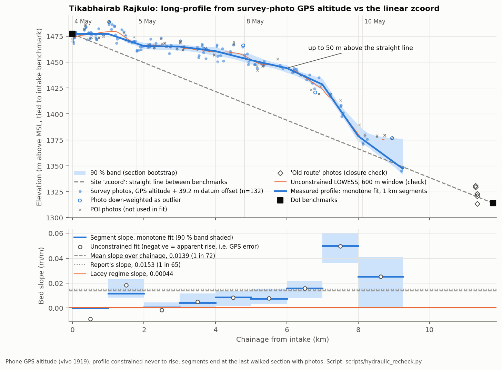
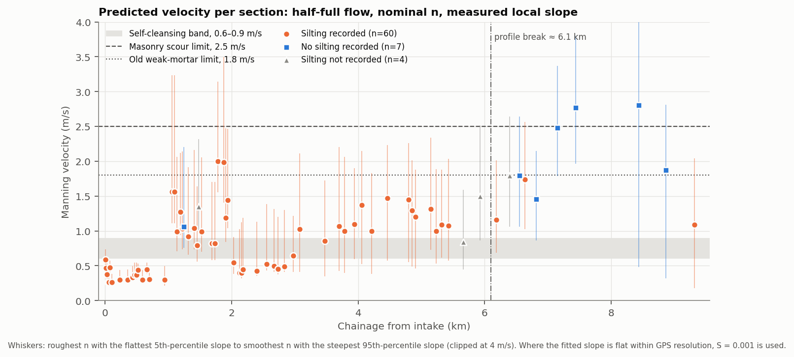
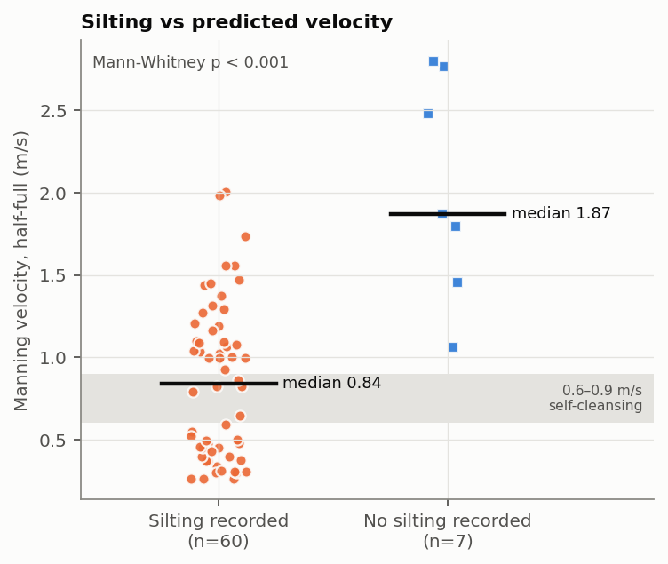

# Hydraulic re-check of the Tikabhairab Rajkulo

*Technical note, November 2026 — internal record only. It documents why the hydraulic claim of earlier drafts was withdrawn. Bed slope was never measured, so neither the site nor the report draws any hydraulic conclusion, and nothing below is quoted in them. Every number and figure below is reproduced by `scripts/hydraulic_recheck.py` (see [Reproducing](#8-reproducing)). Tables between `AUTO` markers are rewritten by that script.*

## Summary

- **"34.8× steeper than Lacey's self-cleansing slope" does not survive.**
  - The arithmetic is right for the report's inputs: 0.01529 ÷ 0.000439 = 34.8.
  - **The length is wrong.** The slope uses the GPS-walked length (10,668.5 m), not the main-line chainage (11,773.3 m) that the site's own elevations use. On the chainage the slope is 0.0139 (1 in 72) and the ratio is 31.5.
  - **The yardstick is wrong.** Lacey's equations describe *unlined alluvial* channels that shape their own bed. 81 of the 83 sections with a lining record are lined. In an alluvial channel, a slope above regime slope means a tendency to *scour*, not proof of self-cleansing.
  - **The average hides the real profile.** The canal's gradient is very uneven. Survey-photo GPS altitudes show the upper 6.1 km falling only about 35 m (S ≈ 0.006, 1 in 177), and in places not measurably at all. The next 3.2 km fall about 96 m (S ≈ 0.03, 1 in 33). The straight-line `zcoord` is up to **50 m** off in mid-canal.
- **"Deterioration is entirely human-caused" does not survive.**
  - **Silting tracks the gradient.** It was recorded in 57 of the 58 upper-reach sections that have a silting record. It was recorded as absent in 6 of the 9 lower-reach sections with a record.
  - **Silted sections are predicted to run slowly.** Their predicted half-full velocity (median 0.84 m/s) is less than half that of clean sections (median 1.87 m/s; Mann–Whitney p = 0.0002).
  - **Flow regime does not explain it.** The contrast holds when the river-fed perennial reach is excluded (p = 0.0005).
  - **Human pressures still matter.** Intake blockage, dumping, sewage and encroachment are real and documented. But the gentle upper gradient makes that reach prone to silting on its own, and the steep lower reach is at or above the scour limit for old masonry in places.
- **Defensible replacement claim:** the canal has two hydraulic characters. Its gentle upper 6 km is prone to silting and needs sediment control and regular desilting. Its steep lower 3 km self-cleans and is at risk of scour. Silting reflects both that gradient and neglect, and this survey cannot apportion the two. The site and the report now say this; see [§7](#7-where-the-revised-finding-now-appears).

## 1. Why a re-check

The review of the Analysis tab identified three problems:

1. **Length basis.** S_actual = 163.14 m / 10,668.5 m mixes the elevation drop between the two DoI benchmarks with the length of the GPS-walked sections only. The site's `zcoord` uses the main-line chainage, 11,773.3 m, giving S = 0.01386 (1 in 72.2) and a Lacey ratio of 31.5. Against the 13,158.2 m AutoCAD length the ratio is 28.2.
2. **Wrong yardstick.** Lacey's regime slope, S₀ = f^5/3 / (3340 Q^1/6) = 0.000439 for Q = 0.10 m³/s and f = 1.0, is the slope at which an unlined alluvial channel stops adjusting its own bed and banks. It says nothing direct about a lined channel of fixed shape. For a lined channel, the relevant checks are:
   - is the velocity at realistic flow depths high enough to carry the sediment (self-cleansing)?
   - is it low enough not to damage the lining (scour)?
3. **No measured profile.** `zcoord` is a straight line from 1,477.16 m at the intake to 1,314.02 m at the outlet. A straight line cannot show where the canal is flat, which is where silt settles. The report itself says per-section slope "varies considerably" (§6.1, §6.8).

## 2. Data

| Input | Source | Used for |
|---|---|---|
| Section geometry, chainage, `zcoord`, width/height/diameter (cm), shape, lining yes/no, silting, flow regime, photo filenames | `CANAL_SECTIONS` in `site/data.js`, working copy on branch `improve/data-and-ux` (sha1 prefix `bbc3eba1dd75`). The committed `HEAD` version has no chainage. | everything |
| Lining material (`ClinedM`, `ClinedMother`) | `Syrvey.gpkg` layer `Survey_new`, joined on Mergin fid. All 95 GPS-walked sections were confirmed by shared photo names. | Manning's n |
| GPS latitude / longitude / altitude, timestamps | EXIF of the survey photos in `Rajkulo All Documents\RajkuloSurvey\rajkulo_survey`, falling back to `Mergin Maps Data\CANAL1` | long-profile |
| Benchmarks | DoI: 1,477.16 m (intake), 1,314.02 m (outlet), as used for `zcoord` | datum tie, comparison |

**Photos.** The sections list 147 unique photos, of which 141 were used:

- **Excluded:** one file is not in either folder (`IMG_20220508_150014.jpg`), and five have no GPS tags.
- **Fit set:** the 141 usable photos were all taken with one phone (vivo 1919), so mixing devices adds no bias. Each GPS fix is within 2 s of the shutter time, and the median distance from photo to section line is 2.8 m. 136 photos lie on the main line and form the fit set.
- **Branches:** five photos lie on walked branches (PDF #92, #93 and the "Old route", #100).
- **Point-of-interest (POI) photos:** these were taken on the same walks and are used only in a sensitivity run and in the closure check.

## 3. Method

### 3.1 Measured long-profile (step a)

1. **Snap each photo to its own section.** For every filename in `CANAL_SECTIONS[].photos`, the photo's GPS position is projected onto that section's GPS-walked polyline. The fraction along the line gives its chainage: (section end chainage − `sec_len`) + fraction × `sec_len`. A photo listed under two sections goes to the nearer line. No photo was more than 50 m from its line.
2. **Fit a monotone profile.** Altitudes are fitted with a continuous piecewise-linear profile with 1 km segments (the last one runs from 8.0 to 9.26 km). The fit has a free intercept and each segment slope is constrained to be ≥ 0, because an open channel cannot run uphill. It is solved by non-negative least squares with two rounds of bisquare reweighting to damp outliers.
3. **Estimate the datum.** The free intercept estimates the phone's datum offset from all photos at once, and the profile is then pinned to 1,477.16 m at chainage 0. The offset is +39.2 m. The 13 photos within 100 m of the intake alone give +42.8 m. The phone reads about 40 m low. That probably means it records height above the WGS-84 ellipsoid rather than above mean sea level (the geoid lies below the ellipsoid over Nepal), plus some GPS bias. Whatever the cause, a constant offset has no effect on slopes.
4. **Uncertainty.** A cluster bootstrap (1,000 resamples of whole sections, so photos of the same section stay together) gives 90 % bands.
   - Where the constraint binds, the constrained bootstrap understates the uncertainty. The upper bound of each slope therefore also takes the 95th percentile of an *unconstrained* fit.
   - An unconstrained robust LOWESS curve (600 m half-window) is drawn as a cross-check.
5. **Day-level checks.** The four survey days are also fitted separately (straight line per day), and the altitude jump where consecutive days meet is recorded. Within-day slopes cannot be affected by day-to-day GPS bias.

### 3.2 Manning velocities (step b)

V = (1/n) R^2/3 S^1/2 is evaluated for every GPS-walked **main-line** section that is rectangular or circular and has dimensions: 71 sections, 65 rectangular and 6 circular.

- **Slope S:** the fitted profile's mean slope over the section's own span. Where the fit is flat (S < 0.001, i.e. no fall measurable within GPS resolution), a nominal S = 0.001 (1 in 1,000) is used and the section is flagged.
- **Manning's n:** from Chow (1959), *Open-Channel Hydraulics*, Table 5-6, by the lining material recorded in `Survey_new`. Values are (minimum / normal / maximum):

  | Lining (sections) | n | Chow category |
  |---|---|---|
  | Brick (24) | 0.012 / **0.015** / 0.018 | brick in cement mortar |
  | Stone (27) | 0.017 / **0.025** / 0.030 | cemented rubble masonry |
  | Concrete (9) | 0.014 / **0.017** / 0.020 | unfinished concrete |
  | Mixed (2) and unrecorded lined (2) | 0.015 / **0.020** / 0.025 | interpolated between brick and stone |
  | Concrete (hume) pipe (5) | 0.011 / **0.013** / 0.015 | concrete culvert with joints and some debris |
  | PVC pipe (1) | 0.009 / **0.010** / 0.011 | |
  | Unlined (1) | 0.022 / **0.027** / 0.033 | earth with short grass and few weeds |

- **Flow depth y:** no discharge was measured, so depths are set as fractions of the section depth (rectangular) or diameter (pipe): y = 0.25, **0.50 (central case)** and 0.80. At y = 0.5 the median section carries 0.081 m³/s (range 0.016–0.59), close to the report's reference Q = 0.10 m³/s.
- **Velocity range:** each section's range runs from the rough case (maximum n, 5th-percentile slope) to the smooth case (minimum n, 95th-percentile slope), at y = 0.5.
- **Thresholds:**
  - **Self-cleansing:** 0.6–0.9 m/s, the usual design minimum for lined channels and drains that carry sand and grit. The report describes the deposits as a coarse-gravel-and-silt mix.
  - **Scour:** 2.5 m/s for brick or stone masonry in cement mortar, and 1.8 m/s for old masonry in lime or mud mortar. These are conventional design limits, not site-measured.
  - **Kennedy's critical velocity** (V_c = 0.55 D^0.64, m = 1), the report's own criterion, is also computed at y = 0.5.

### 3.3 Silting vs velocity (step c)

The survey's silting field (Present / Absent) is compared with the central velocity and the slope. The tests are a two-sided Mann–Whitney test and a Fisher exact test on V < 0.9 m/s. They are run on all sections, and again on seasonal-flow sections only, which removes the river-fed perennial reach as an explanation.

## 4. Results

### 4.1 The canal is not uniformly steep



*Figure H1. Top: datum-corrected photo altitudes with the monotone profile and its 90 % band, the unconstrained LOWESS check, and the straight-line `zcoord`. Bottom: slope per 1 km segment against the average slope, the report's slope and Lacey's regime slope.*

<!-- BEGIN AUTO: reach-table -->
| Reach (km) | Measured drop (m) | 90 % range (m) | Mean slope | Straight-line drop (m) |
|---|---:|---|---:|---:|
| 0.00–6.10 | 34.5 | 31.8–38.4 | 0.0057 | 84.5 |
| 6.10–9.26 | 95.6 | 65.7–101.0 | 0.0303 | 43.7 |
| 0.00–9.26 | 130.1 | 100.9–135.8 | 0.0141 | 128.2 |
<!-- END AUTO: reach-table -->

The upper/lower break at 6.1 km is the best single breakpoint of an unconstrained two-piece fit. That fit gives slopes of 0.0051 above the break and 0.0315 below it.

<!-- BEGIN AUTO: segment-table -->
| Segment (km) | Photos | Slope S (monotone fit) | 90 % range | Unconstrained fit | Drop (m) | Drop on straight line (m) |
|---|---:|---:|---|---:|---:|---:|
| 0.0–1.00 | 31 | 0.0000 | 0.0000–0.0000 | -0.0088 | 0.0 | 13.9 |
| 1.0–2.00 | 25 | 0.0116 | 0.0085–0.0232 | +0.0183 | 11.6 | 13.9 |
| 2.0–3.00 | 14 | 0.0005 | 0.0000–0.0045 | -0.0014 | 0.5 | 13.9 |
| 3.0–4.00 | 13 | 0.0043 | 0.0000–0.0118 | +0.0051 | 4.3 | 13.9 |
| 4.0–5.00 | 17 | 0.0088 | 0.0018–0.0137 | +0.0085 | 8.8 | 13.9 |
| 5.0–6.00 | 10 | 0.0077 | 0.0034–0.0154 | +0.0078 | 7.7 | 13.9 |
| 6.0–7.00 | 13 | 0.0158 | 0.0079–0.0220 | +0.0158 | 15.8 | 13.9 |
| 7.0–8.00 | 6 | 0.0498 | 0.0361–0.0601 | +0.0497 | 49.8 | 13.9 |
| 8.0–9.26 | 7 | 0.0252 | 0.0000–0.0406 | +0.0252 | 31.6 | 17.4 |
<!-- END AUTO: segment-table -->

What this shows:

- **Upper 6.1 km: flat.** It falls about 35 m (90 % range 32–38 m), where the straight line assumes 85 m. Its mean slope of 0.0057 is about 40 % of the canal-wide average, and 13 times Lacey's slope rather than 35 times.
- **Within-day fits agree.** These cannot be affected by day-to-day GPS bias:

  | Day | Chainage (km) | Photos | Slope (± SE) | Drop (m) | Straight-line drop (m) |
  |---|---|---:|---|---:|---:|
  | 4 May | 0.0–1.76 | 50 | 0.0003 ± 0.0013 | 0.6 | 24.3 |
  | 5 May | 1.80–4.78 | 45 | 0.0019 ± 0.0008 | 5.7 | 41.2 |
  | 8 May | 4.82–7.58 | 34 | 0.0167 ± 0.0013 | 46.2 | 38.3 |
  | 10 May | 8.13–9.26 | 7 | 0.021 ± 0.007 | 23.5 | 15.6 |

  For the straight line to be right, the phone would have had to drift by about 24 m in five hours on 4 May and by about 35 m in four hours on 5 May. That is implausible.
- **Lower 3.2 km: steep.** From 6.1 to 9.26 km the canal falls about 96 m (S ≈ 0.03, 1 in 33). The 7–8 km segment alone falls about 50 m, but it spans a 550 m gap in the photos and a change of survey day, so treat that one value with care.
- **The profile closes.** From the intake to 9.26 km the measured drop (130 m) matches the straight line (128 m). Six photos on the "Old route" near 11.34 km read 1,322.8 m (range 1,313–1,331 m) against 1,320.1 m on the straight line: tied only at the intake, the phone heights land within 3 m of the outlet benchmark line.
- **The first kilometre shows no measurable fall.** Unconstrained, the photos there even *rise* about 9 m, which is GPS error (possibly multipath in the gorge at the temple). Its slope cannot be resolved from these data.
- **Day-junction steps.** Where 4→5 May and 5→8 May meet (gaps under 50 m), the altitude steps down 9.1 m each time. If those steps are GPS bias rather than real drops, the upper 6.1 km falls only about 15 m (see [§4.4](#44-sensitivity)). Either way it is far flatter than the straight line.

### 4.2 Predicted velocities



*Figure H2. Velocity per section at half-full flow, nominal n and the fitted slope. Marker colour shows the survey's silting record. Whiskers span the rough-to-smooth range described in [§3.2](#32-manning-velocities-step-b).*

<!-- BEGIN AUTO: class-table -->
| Class (half-full, nominal n, fitted slope) | Sections |
|---|---:|
| below self-cleansing | 26 |
| marginal | 6 |
| self-cleansing | 37 |
| above scour limit | 2 |
<!-- END AUTO: class-table -->

- **Upper reach (0–6.1 km, 61 sections):**
  - 26 are below 0.6 m/s, 6 are marginal (0.6–0.9 m/s), and 29 reach 0.9 m/s or more.
  - The 16 sections in the first kilometre are below 0.6 m/s at the assumed 1 in 1,000 slope (median 0.35 m/s). Here the velocity follows from the assumed slope, not from a measurement, because the GPS profile shows no fall in that stretch.
  - The median first-kilometre section would need a true fall of about 0.003 (1 in 340) to reach 0.6 m/s, and about 0.0066 (1 in 150) to reach 0.9 m/s. That means 3–7 m of fall over the kilometre. The photos cannot rule this out, because they show the first kilometre *rising* about 9 m, which is itself a GPS error at least that large.
- **Lower reach (6.1–9.26 km, 10 sections):** all are self-cleansing.
  - Two exceed the 2.5 m/s scour limit at half-full: PDF #88 (2.8 m/s, brick) and PDF #91 (2.8 m/s, hume pipe).
  - At 80 % depth, 3 sections exceed 2.5 m/s, and 10 across the canal exceed the 1.8 m/s weak-mortar limit.
  - The steep reach is mainly a **scour** risk rather than a silting risk, which matters for how it is restored.
- **Against Kennedy's V_c:** every section passes the report's own criterion (V_c = 0.12–0.33 m/s at these depths), even at 1 in 1,000. Kennedy's V_c is set for fine alluvial silt. Yet sections here silt at predicted velocities far above it: the median silted section runs at 0.84 m/s ([§4.3](#43-where-silting-was-recorded)). So the sediment needs more than Kennedy's velocities to move, which fits the coarse-gravel-and-silt deposits the report describes.

<details>
<summary>Per-section results (71 main-line sections with dimensions)</summary>

<!-- BEGIN AUTO: section-table -->
| PDF # | Tole | Chainage (m) | Shape, size (cm) | Lining → n | Slope S (90 % range) | V at y = 0.25 / 0.5 / 0.8 depth (m/s) | V range (m/s) | Class (y = 0.5) | Silting |
|---:|---|---|---|---|---|---|---|---|---|
| 1 | Intake | 0–14 | rect 72×50 | brick → 0.015 | flat, 0.001 used [0.0000–0.0000] | 0.43 / 0.59 / 0.70 | 0.49–0.74 | below self-cleansing | Present |
| 2 | intake 2 | 25–47 | rect 72×58 | stone → 0.025 | flat, 0.001 used [0.0000–0.0000] | 0.28 / 0.37 / 0.44 | 0.31–0.55 | below self-cleansing | Present |
| 3 | intake2.1 | 47–52 | rect 42×34 | stone → 0.025 | flat, 0.001 used [0.0000–0.0000] | 0.19 / 0.26 / 0.31 | 0.22–0.38 | below self-cleansing | Present |
| 4 | intake2.2 | 52–73 | rect 42×34 | stone → 0.025 | flat, 0.001 used [0.0000–0.0000] | 0.19 / 0.26 / 0.31 | 0.22–0.38 | below self-cleansing | Present |
| 5 | Intake3 | 14–25 | pipe Ø34 | pipe → 0.013 | flat, 0.001 used [0.0000–0.0000] | 0.33 / 0.47 / 0.54 | 0.41–0.56 | below self-cleansing | Present |
| 6 | 4 | 73–84 | rect 67×42 | concrete → 0.017 | flat, 0.001 used [0.0000–0.0000] | 0.35 / 0.48 / 0.57 | 0.40–0.58 | below self-cleansing | Present |
| 7 | 3.4 | 84–130 | rect 78×25 | stone → 0.025 | flat, 0.001 used [0.0000–0.0000] | 0.18 / 0.26 / 0.33 | 0.22–0.39 | below self-cleansing | Present |
| 8 | 4 | 130–335 | rect 85×32 | stone → 0.025 | flat, 0.001 used [0.0000–0.0000] | 0.21 / 0.30 / 0.37 | 0.25–0.44 | below self-cleansing | Present |
| 9 | 5 | 335–377 | rect 86×32 | stone → 0.025 | flat, 0.001 used [0.0000–0.0000] | 0.21 / 0.30 / 0.37 | 0.25–0.44 | below self-cleansing | Present |
| 11 | 7 | 415–454 | rect 86×40 | stone → 0.025 | flat, 0.001 used [0.0000–0.0000] | 0.24 / 0.34 / 0.41 | 0.28–0.49 | below self-cleansing | Present |
| 12 | 8 | 454–485 | rect 126×42 | stone → 0.025 | flat, 0.001 used [0.0000–0.0000] | 0.25 / 0.37 / 0.46 | 0.31–0.54 | below self-cleansing | Present |
| 13 | 9 | 485–509 | rect 126×42 | stone → 0.025 | flat, 0.001 used [0.0000–0.0000] | 0.25 / 0.37 / 0.46 | 0.31–0.54 | below self-cleansing | Present |
| 14 | 10 | 509–531 | rect 65×35 | concrete → 0.017 | flat, 0.001 used [0.0000–0.0000] | 0.31 / 0.44 / 0.53 | 0.37–0.53 | below self-cleansing | Present |
| 15 | 11 | 531–650 | rect 65×35 | stone → 0.025 | flat, 0.001 used [0.0000–0.0000] | 0.21 / 0.30 / 0.36 | 0.25–0.44 | below self-cleansing | Present |
| 16 | 12 | 650–669 | rect 58×40 | concrete → 0.017 | flat, 0.001 used [0.0000–0.0000] | 0.33 / 0.45 / 0.53 | 0.38–0.54 | below self-cleansing | Present |
| 17 | 13 | 669–736 | rect 56×42 | stone → 0.025 | flat, 0.001 used [0.0000–0.0000] | 0.23 / 0.31 / 0.36 | 0.26–0.45 | below self-cleansing | Present |
| 19 | 15 | 866–1026 | rect 52×20 | stone → 0.025 | 0.0019 [0.0014–0.0024] | 0.21 / 0.30 / 0.37 | 0.21–0.50 | below self-cleansing | Present |
| 20 | 17 | 1026–1090 | rect 90×84 | stone → 0.025 | 0.0116 [0.0085–0.0232] | 1.18 / 1.56 / 1.80 | 1.11–3.24 | self-cleansing | Present |
| 21 | 18 | 1090–1105 | rect 84×90 | stone → 0.025 | 0.0116 [0.0085–0.0232] | 1.20 / 1.56 / 1.78 | 1.11–3.24 | self-cleansing | Present |
| 22 | 18 | 1105–1178 | rect 57×36 | stone → 0.025 | 0.0116 [0.0085–0.0232] | 0.72 / 0.99 / 1.18 | 0.71–2.06 | self-cleansing | Present |
| 23 | 20 | 1178–1207 | pipe Ø24 | pipe → 0.013 | 0.0116 [0.0085–0.0232] | 0.89 / 1.27 / 1.45 | 0.94–2.12 | self-cleansing | Present |
| 24 | 20 | 1207–1234 | rect 53×42 | stone → 0.025 | 0.0116 [0.0085–0.0232] | 0.77 / 1.03 / 1.21 | 0.73–2.14 | self-cleansing | Present |
| 25 | 21 | 1234–1253 | rect 46×52 | stone → 0.025 | 0.0116 [0.0085–0.0232] | 0.82 / 1.06 / 1.21 | 0.75–2.20 | self-cleansing | Absent |
| 26 | — | 1253–1380 | rect 58×30 | stone → 0.025 | 0.0116 [0.0085–0.0232] | 0.66 / 0.92 / 1.11 | 0.66–1.91 | self-cleansing | Present |
| 27 | 23 | 1380–1436 | rect 58×40 | stone → 0.025 | 0.0116 [0.0085–0.0232] | 0.76 / 1.04 / 1.23 | 0.74–2.16 | self-cleansing | Present |
| 28 | 24 | 1436–1479 | rect 42×25 | stone → 0.025 | 0.0116 [0.0085–0.0232] | 0.57 / 0.79 / 0.94 | 0.56–1.64 | marginal | Present |
| 29 | 25 | 1479–1485 | rect 42×37 | concrete → 0.017 | 0.0116 [0.0085–0.0232] | 1.02 / 1.35 / 1.57 | 0.98–2.32 | self-cleansing | — |
| 30 | 26 | 1485–1568 | rect 52×38 | stone → 0.025 | 0.0116 [0.0085–0.0232] | 0.73 / 0.99 / 1.16 | 0.70–2.05 | self-cleansing | Present |
| 32 | 27 | 1658–1718 | rect 54×24 | stone → 0.025 | 0.0116 [0.0085–0.0232] | 0.58 / 0.82 / 1.00 | 0.58–1.70 | marginal | Present |
| 33 | 29 | 1718–1757 | rect 54×24 | stone → 0.025 | 0.0116 [0.0085–0.0232] | 0.58 / 0.82 / 1.00 | 0.58–1.70 | marginal | Present |
| 34 | 30 | 1757–1805 | pipe Ø32 | pvc → 0.010 | 0.0116 [0.0085–0.0232] | 1.40 / 2.00 / 2.28 | 1.55–3.14 | self-cleansing | Present |
| 36 | 31 | 1857–1899 | rect 60×56 | brick → 0.015 | 0.0116 [0.0085–0.0232] | 1.50 / 1.98 / 2.29 | 1.41–3.50 | self-cleansing | Present |
| 37 | 32 | 1899–1921 | rect 60×56 | stone → 0.025 | 0.0116 [0.0085–0.0232] | 0.90 / 1.19 / 1.37 | 0.85–2.47 | self-cleansing | Present |
| 38 | 32 | 1921–1960 | rect 50×38 | concrete → 0.017 | 0.0116 [0.0085–0.0232] | 1.07 / 1.44 / 1.69 | 1.04–2.47 | self-cleansing | Present |
| 39 | 33 | 1960–2108 | rect 65×40 | unlined → 0.027 | 0.0035 [0.0026–0.0066] | 0.40 / 0.55 / 0.65 | 0.38–0.91 | below self-cleansing | Present |
| 40 | 35 | 2108–2150 | rect 52×32 | concrete → 0.017 | flat, 0.001 used [0.0000–0.0045] | 0.29 / 0.40 / 0.47 | 0.34–1.03 | below self-cleansing | Present |
| 41 | 36 | 2150–2166 | rect 68×40 | mixed → 0.020 | flat, 0.001 used [0.0000–0.0045] | 0.29 / 0.40 / 0.48 | 0.32–1.12 | below self-cleansing | Present |
| 42 | 36 | 2166–2197 | rect 66×28 | brick → 0.015 | flat, 0.001 used [0.0000–0.0045] | 0.31 / 0.45 / 0.55 | 0.37–1.19 | below self-cleansing | Present |
| 45 | 38 | 2327–2478 | rect 68×25 | brick → 0.015 | flat, 0.001 used [0.0000–0.0045] | 0.30 / 0.43 / 0.53 | 0.36–1.13 | below self-cleansing | Present |
| 46 | — | 2478–2637 | rect 70×38 | brick → 0.015 | flat, 0.001 used [0.0000–0.0045] | 0.37 / 0.52 / 0.63 | 0.43–1.38 | below self-cleansing | Present |
| 47 | 40 | 2637–2706 | rect 80×32 | brick → 0.015 | flat, 0.001 used [0.0000–0.0045] | 0.35 / 0.50 / 0.61 | 0.41–1.32 | below self-cleansing | Present |
| 48 | 40 | 2706–2759 | rect 53×32 | brick → 0.015 | flat, 0.001 used [0.0000–0.0045] | 0.33 / 0.45 / 0.54 | 0.38–1.20 | below self-cleansing | Present |
| 49 | 42 | 2759–2919 | rect 76×32 | brick → 0.015 | flat, 0.001 used [0.0000–0.0045] | 0.34 / 0.49 / 0.60 | 0.41–1.30 | below self-cleansing | Present |
| 50 | 43 | 2919–3036 | rect 76×32 | brick → 0.015 | 0.0017 [0.0005–0.0039] | 0.45 / 0.65 / 0.79 | 0.41–1.22 | marginal | Present |
| 51 | 43 | 3036–3124 | rect 76×32 | brick → 0.015 | 0.0043 [0.0000–0.0118] | 0.72 / 1.02 / 1.25 | 0.41–2.11 | self-cleansing | Present |
| 53 | 44 | 3441–3499 | rect 50×36 | concrete → 0.017 | 0.0043 [0.0000–0.0118] | 0.63 / 0.86 / 1.01 | 0.35–1.72 | marginal | Present |
| 57 | 47 | 3670–3726 | rect 72×36 | brick → 0.015 | 0.0043 [0.0000–0.0118] | 0.76 / 1.07 / 1.29 | 0.43–2.20 | self-cleansing | Present |
| 59 | 49 | 3739–3833 | rect 68×32 | brick → 0.015 | 0.0043 [0.0000–0.0118] | 0.71 / 1.00 / 1.22 | 0.40–2.06 | self-cleansing | Present |
| 60 | 50 | 3833–4049 | rect 58×34 | brick → 0.015 | 0.0053 [0.0022–0.0102] | 0.79 / 1.10 / 1.32 | 0.59–1.90 | self-cleansing | Present |
| 61 | 52 | 4049–4066 | rect 58×32 | brick → 0.015 | 0.0088 [0.0018–0.0137] | 0.99 / 1.37 / 1.65 | 0.52–2.14 | self-cleansing | Present |
| 64 | 54 | 4195–4227 | rect 64×48 | stone → 0.025 | 0.0088 [0.0018–0.0137] | 0.74 / 1.00 / 1.17 | 0.38–1.83 | self-cleansing | Present |
| 66 | 56 | 4417–4513 | rect 65×48 | concrete → 0.017 | 0.0088 [0.0018–0.0137] | 1.09 / 1.47 / 1.73 | 0.57–2.23 | self-cleansing | Present |
| 68 | a | 4781–4821 | rect 74×32 | brick → 0.015 | 0.0088 [0.0018–0.0137] | 1.02 / 1.45 / 1.77 | 0.55–2.26 | self-cleansing | Present |
| 69 | b | 4821–4888 | rect 34×42 | brick → 0.015 | 0.0088 [0.0018–0.0137] | 1.01 / 1.29 / 1.46 | 0.49–2.02 | self-cleansing | Present |
| 70 | c | 4888–4929 | rect 32×36 | brick → 0.015 | 0.0088 [0.0018–0.0137] | 0.93 / 1.20 / 1.37 | 0.46–1.88 | self-cleansing | Present |
| 72 | E | 5119–5180 | rect 65×32 | brick → 0.015 | 0.0077 [0.0034–0.0154] | 0.94 / 1.32 / 1.60 | 0.73–2.34 | self-cleansing | Present |
| 73 | f | 5180–5283 | rect 68×32 | mixed → 0.020 | 0.0077 [0.0034–0.0154] | 0.71 / 1.00 / 1.21 | 0.53–1.89 | self-cleansing | Present |
| 74 | g | 5283–5352 | rect 64×28 | concrete → 0.017 | 0.0077 [0.0034–0.0154] | 0.77 / 1.09 / 1.33 | 0.62–1.88 | self-cleansing | Present |
| 75 | h | 5352–5513 | rect 68×38 | unknown → 0.020 | 0.0077 [0.0034–0.0154] | 0.77 / 1.08 / 1.29 | 0.57–2.04 | self-cleansing | Present |
| 76 | i | 5513–5812 | rect 56×24 | unknown → 0.020 | 0.0077 [0.0034–0.0154] | 0.59 / 0.84 / 1.03 | 0.45–1.59 | marginal | — |
| 78 | k | 5887–5971 | pipe Ø42 | pipe → 0.013 | 0.0077 [0.0034–0.0154] | 1.05 / 1.50 / 1.71 | 0.86–2.51 | self-cleansing | — |
| 80 | l | 6170–6201 | rect 58×36 | stone → 0.025 | 0.0158 [0.0079–0.0220] | 0.84 / 1.16 / 1.38 | 0.69–2.02 | self-cleansing | Present |
| 83 | m | 6291–6498 | rect 44×36 | brick → 0.015 | 0.0158 [0.0079–0.0220] | 1.34 / 1.79 / 2.09 | 1.06–2.64 | self-cleansing | — |
| 84 | n | 6498–6594 | rect 44×36 | brick → 0.015 | 0.0158 [0.0079–0.0220] | 1.34 / 1.79 / 2.09 | 1.06–2.64 | self-cleansing | Absent |
| 85 | O | 6594–6681 | rect 58×28 | brick → 0.015 | 0.0158 [0.0079–0.0220] | 1.23 / 1.74 / 2.11 | 1.03–2.56 | self-cleansing | Present |
| 86 | p | 6681–6955 | rect 30×28 | brick → 0.015 | 0.0158 [0.0079–0.0220] | 1.10 / 1.46 / 1.68 | 0.86–2.15 | self-cleansing | Absent |
| 87 | q | 6955–7345 | rect 30×28 | brick → 0.015 | 0.0458 [0.0342–0.0541] | 1.88 / 2.48 / 2.86 | 1.79–3.37 | self-cleansing | Absent |
| 88 | r | 7345–7526 | rect 42×26 | brick → 0.015 | 0.0498 [0.0361–0.0601] | 2.01 / 2.77 / 3.30 | 1.96–3.80 | above scour limit | Absent |
| 91 | a1 | 8134–8738 | pipe Ø44 | pipe → 0.013 | 0.0252 [0.0000–0.0406] | 1.96 / 2.80 / 3.19 | 0.48–4.21 | above scour limit | Absent |
| 94 | D1 | 8738–8982 | pipe Ø24 | pipe → 0.013 | 0.0252 [0.0000–0.0406] | 1.31 / 1.87 / 2.13 | 0.32–2.81 | self-cleansing | Absent |
| 95 | f1 | 8982–9650 | rect 50×20 | stone → 0.025 | 0.0252 [0.0000–0.0406] | 0.76 / 1.09 / 1.34 | 0.18–2.04 | self-cleansing | Present |
<!-- END AUTO: section-table -->

</details>

The same table, with more columns, is in `research/data/hydraulic_recheck_sections.csv`.

### 4.3 Where silting was recorded



*Figure H3. Central velocity of sections with and without recorded silting.*

| | Silting recorded | No silting recorded |
|---|---:|---:|
| Sections (main line, with dimensions) | 60 | 7 |
| Median velocity, half-full (m/s) | 0.84 | 1.87 |
| Median fitted slope | 0.0043 | 0.025 |
| Sections with V < 0.9 m/s | 31 (52 %) | 0 |
| Seasonal-flow sections only: median V (n) | 1.10 (16) | 2.18 (6) |

- **Tests:** Mann–Whitney on velocity p = 0.0002 and on slope p = 0.00005. Fisher exact on V < 0.9 m/s p = 0.013. Seasonal-flow sections only, on velocity: p = 0.0005.
- **Clean sections cluster in the steep reach.** Six of the seven sections recorded without silting lie between 6.6 and 9.0 km. The seventh is at 1.25 km (PDF #25).
- **Caveats.** Silting is present/absent only, and nearly every section is silted. Because the clean sections cluster in one reach, the test is in effect a comparison of the two reaches.
  - Distance from the sediment-laden river intake and urban inputs also change along the canal, so these data cannot separate gradient from sediment supply.
  - Flow regime does not explain the pattern. Inside the seasonal-flow stretch, the gentle 3.4–6.1 km part is silted throughout and the steep 6.1–9.3 km part mostly is not.

### 4.4 Sensitivity

The upper/lower break is fixed at 6.1 km for every variant. The class counts use y = 0.5, nominal n and the fitted slope.

<!-- BEGIN AUTO: sensitivity-table -->
| Variant | Datum offset (m) | Drop above break (m) | Drop below break (m) | Below / marginal / self-cleansing / above scour | Silting median V present vs absent (m/s) | Mann-Whitney p |
|---|---:|---:|---:|---|---|---:|
| Primary: 1 km segments, section photos | +39.2 | 34.5 | 95.6 | 26 / 6 / 37 / 2 | 0.84 vs 1.87 | < 0.001 |
| 750 m segments | +39.9 | 31.8 | 97.4 | 34 / 8 / 28 / 1 | 0.58 vs 2.09 | < 0.001 |
| 1.5 km segments | +39.6 | 32.8 | 99.0 | 21 / 18 / 31 / 1 | 0.79 vs 2.09 | 0.001 |
| 1 km segments shifted by 500 m | +39.9 | 35.0 | 94.2 | 24 / 21 / 23 / 3 | 0.65 vs 2.11 | 0.001 |
| + 62 POI photos | +38.5 | 34.6 | 86.5 | 26 / 6 / 38 / 1 | 0.86 vs 2.08 | < 0.001 |
| Day offsets removed at the two short-gap junctions | +39.8 | 15.4 | 95.7 | 42 / 9 / 18 / 2 | 0.48 vs 1.87 | < 0.001 |
<!-- END AUTO: sensitivity-table -->

- **Holds in every variant:**
  - the upper 6.1 km falls 15–35 m, against 85 m on the straight line;
  - the lower reach falls 86–99 m;
  - silted sections have markedly lower predicted velocities (p ≤ 0.002).
- **Shifts between variants:** how many individual sections fall in each class (21–42 below self-cleansing). Section-level slopes are only as good as phone GPS over about 1 km.
- **Flow depth:** across the 71 sections, velocity at y = 0.25 is 22–31 % lower than at 0.5 (median 28 %), and at 0.8 it is 13–25 % higher (median 19 %). The y = 0.25 case would move many marginal sections below 0.6 m/s.

## 5. What survives of the original claims

| Original claim | Verdict | Why |
|---|---|---|
| S_actual = 0.01529 (1 in 65) | **Revise** | Use the main-line chainage: 163.14 / 11,773.3 = 0.0139 (1 in 72). Better still, describe the measured profile: about 1 in 177 over the upper 6.1 km and 1 in 33 over the next 3.2 km. |
| "34.8× steeper than Lacey's self-cleansing slope" | **Drop** | Wrong length (31.5× on chainage), and Lacey's slope is not a self-cleansing threshold for a lined canal. The average hides a near-flat upper reach where the ratio is about 13×, or unresolvable. |
| "The canal's hydraulic design is sound" | **Qualify** | The lower reach self-cleans (and risks scour). The upper reach, at realistic depths and its measured gradient, is marginal to below self-cleansing for sand and grit. A canal of this kind needs sediment exclusion at the intake and regular desilting. |
| Silting "caused entirely by intake blockage, encroachment, and waste dumping" | **Drop "entirely"** | Silting tracks the low-gradient reach (57 of 58 upper sections with a record) and low predicted velocity, also within the seasonal reach. Human pressures add to a hydraulic predisposition. They are not its only cause. |
| Manning V ≫ Kennedy V_c for every lining | **True, but not decisive** | It holds even at 1 in 1,000, which shows that Kennedy's fine-silt criterion cannot explain the strong silting pattern. Use a sand/grit threshold (0.6–0.9 m/s) and local slopes. |

## 6. Limitations

- **Phone GPS altitude is coarse.** Scatter is about 5 m per photo, and errors are correlated within a day (the 9 m steps at day junctions). The profile resolves reach-scale (about 1 km) gradients only. Flat spots tens of metres long, such as a sag behind a collapsed wall, remain invisible.
- **Assumed values in two places.** No slope is measurable in the first kilometre, where S = 0.001 is assumed. The 7–8 km segment spans a photo gap and a day change.
- **No measured profile below 9.26 km.** The last 2.5 km (buried connector sections) were not walked. Only the "Old route" closure check reaches that far.
- **Depth and discharge are assumed, not measured.** Velocities scale with them. Chow's n values are for clean channels; silt, vegetation and broken lining raise n and lower velocity.
- **Scour limits are generic.** The masonry's actual mortar and condition are unknown.
- **The silting record is coarse.** It is presence/absence, with a high base rate and spatially clustered absences.
- **The input data are uncommitted.** They come from the working copy on `improve/data-and-ux`. If that branch's `CANAL_SECTIONS` changes, rerun the script. Its sha1 prefix is recorded in `research/data/hydraulic_recheck_summary.json`.

**What would settle it:**

1. A level or RTK-GNSS survey of the canal bed. At minimum, cover the first 6 km at roughly 100 m spacing, which is the report's §12.1 priority.
2. Spot measurements of depth and surface velocity (float method) at a few sections in each reach.
3. Grain-size analysis of the deposits.

## 7. Status

After review (November 2026) the hydraulic claim was removed from the site and the report entirely — including the "two gradients" finding first drafted from this re-check, because phone-GPS altitudes are too coarse to carry it. The site's Analysis tab and the report's Chapter 6 now present only what the survey data show directly: the perennial reach, where contamination starts, sewage and waste, silting, lining and the sections lost from view. A level or total-station survey of the canal bed is the prerequisite for any hydraulic conclusion.

## 8. Reproducing

```powershell
python scripts/hydraulic_recheck.py --src "D:\Rajkulo All Documents"
```

The script needs numpy, matplotlib, Pillow and pyogrio, and runs in about 10 s. It writes:

- the three figures, to `research/figures/fig_H*.png`;
- `research/data/hydraulic_recheck_photos.csv`: every photo with its chainage, raw and corrected altitude, fitted and straight-line elevation;
- `research/data/hydraulic_recheck_sections.csv`: per-section slope, n, velocities, class and silting;
- `research/data/hydraulic_recheck_summary.json`: every number quoted above;
- the `AUTO` tables in this file, rewritten in place;
- `site/profile.js` (measured elevation and slope per section), only with `--site`; the site does not use it.

The bootstrap seed is fixed (20220504), so reruns are identical.

## References

- Chow, V. T. (1959). *Open-Channel Hydraulics.* McGraw-Hill. Table 5-6, values of the roughness coefficient n.
- Kennedy, R. G. (1895). The prevention of silting in irrigation canals. *Minutes of Proceedings of the Institution of Civil Engineers*, 119, 281–290.
- Lacey, G. (1930). Stable channels in alluvium. *Minutes of Proceedings of the Institution of Civil Engineers*, 229, 259–292.
- Manning, R. (1891). On the flow of water in open channels and pipes. *Transactions of the Institution of Civil Engineers of Ireland*, 20, 161–207.
